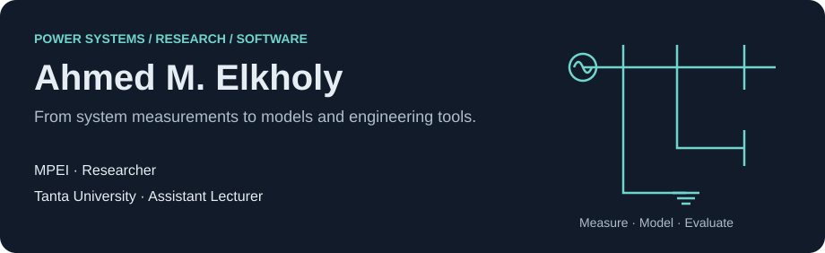
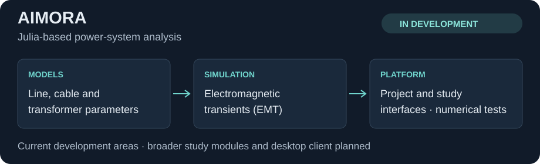
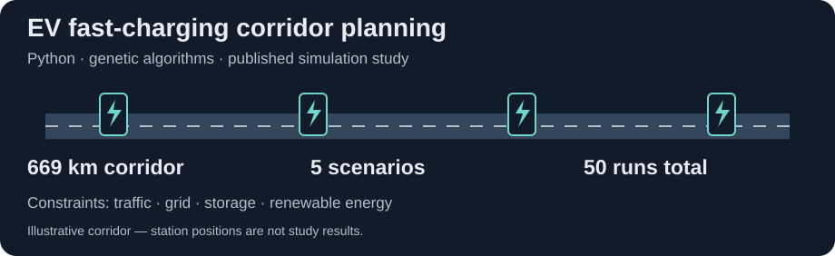

  

  <strong>Professional</strong> 
  <a href="https://ahmelkholy.github.io/">Website &amp; articles</a> &nbsp; · &nbsp;
  <a href="https://www.linkedin.com/in/ahmelkholy/">LinkedIn</a> &nbsp; · &nbsp;
  <a href="https://github.com/ahmelkholy">GitHub</a> &nbsp; · &nbsp;
  <a href="https://tdb2.tanta.edu.eg/staff/ahmelkholy">Tanta University</a> &nbsp; · &nbsp;
  <a href="https://github.com/AIMORA-dev">AIMORA</a>

  <strong>Research</strong> 
  <a href="https://scholar.google.com/citations?user=KbZs8_AAAAAJ&amp;hl=en">Google Scholar</a> &nbsp; · &nbsp;
  <a href="https://orcid.org/0000-0002-1834-1175">ORCID</a> &nbsp; · &nbsp;
  <a href="https://www.researchgate.net/profile/Ahmed-Elkholy-7">ResearchGate</a> &nbsp; · &nbsp;
  <a href="https://www.zotero.org/ahmelkholy">Zotero</a> &nbsp; · &nbsp;
  <a href="https://www.scopus.com/authid/detail.uri?authorId=57202189065">Scopus</a> &nbsp; · &nbsp;
  <a href="https://www.sciprofiles.com/profile/amelkholy">SciProfiles</a>

  <strong>Community</strong> 
  <a href="https://www.youtube.com/@ahmelkholy">YouTube</a> &nbsp; · &nbsp;
  <a href="https://www.facebook.com/ahm.m.elkholy">Facebook</a> &nbsp; · &nbsp;
  <a href="mailto:ahmed_elkholy@f-eng.tanta.edu.eg">University email</a> &nbsp; · &nbsp;
  <a href="mailto:ahm_elkholy@outlook.com">Personal email</a>

I work on **power-system studies, equipment modelling and engineering software**. I am a researcher at **MPEI** and an **Assistant Lecturer at Tanta University**. My PhD on shunt regulation in unbalanced distribution networks is in progress, with completion expected in **December 2026**.

**Explore:** [Projects](#projects) · [Engineering experience](#engineering-experience) · [Tools](#tools) · [Education](#education) · [Research & community](#research--community)

## Projects

### AIMORA · Power-system analysis in Julia

I lead development of AIMORA. Current work covers EMT simulation, line/cable and transformer parameters, project/study interfaces and numerical tests. Broader study modules and the desktop client are planned.

**[Explore AIMORA →](https://github.com/AIMORA-dev)** · [AIMORA.jl](https://github.com/AIMORA-dev/AIMORA.jl) · [Platform](https://github.com/AIMORA-dev/AIMORAPlatform) · [Resources](https://github.com/AIMORA-dev/AIMORAResources)

### EV charging · Corridor planning

As lead author and software developer, I developed Python genetic-algorithm software to locate and size fast chargers under traffic, grid, storage and renewable-energy constraints. The published study evaluates five scenarios over a 669 km motorway corridor, with **50 runs in total**.

**[Read the paper →](https://doi.org/10.1016/j.epsr.2026.113505)**

<strong>More tools · IEEE 13-bus optimisation and Thevenin impedance</strong>

| Tool | What it does | Start here |
| --- | --- | --- |
| **IEEE13-optimization** | Optimises unified power controller settings on the IEEE 13-bus feeder, using the external DPFLOW MATLAB package. | [Repository →](https://github.com/ahmelkholy/IEEE13-optimization) |
| **Zthevenin** | Calculates Thevenin impedance in MATLAB. | [Repository →](https://github.com/ahmelkholy/Zthevenin) |

See each repository's licence for its terms. AIMORA's public source includes noncommercial licensing conditions.

## Engineering experience

**Commissioning and modelling · Power-system studies · Specifications · Teaching**

<strong>MPEI — transformer commissioning, SVC analysis and shunt regulation</strong>

**Researcher / R&D Engineer · Industrial Electronics Department · October 2023–present**

- Participated in zigzag-transformer commissioning tests and developed measurement-based variable-impedance models in MATLAB/Simulink, comparing predictions with measured system behaviour at 50 Hz.
- Contributed to modelling and performance assessment of a departmental **50 kvar, 0.4 kV thyristor-switched SVC**, using R to analyse two months of operating data.
- Developed shunt-regulator models, phase-power calculations and genetic-algorithm coordination of two compensators on the IEEE 13-bus feeder in simulation.

[Zigzag paper](https://doi.org/10.1016/j.prime.2025.101135) · [SVC paper](https://doi.org/10.1016/j.epsr.2024.111187)

<strong>Independent studies — ETAP for industrial and PV projects</strong>

**Project-based · 2024–present**

- Load flow, short circuit, arc flash and protection settings, with reports prepared for client review.
- Capacitor compensation with 7% detuned reactors for a 480 V motor control centre.
- Short-circuit studies of PV installations with battery sources across seven operating scenarios.

<strong>Power Consult — utility equipment specifications</strong>

**Project-based contributor · 2026–present**

Contribute to material specifications and inspection/test plans for energy-storage and controller equipment. Resolve technical review comments and maintain standards references and meeting actions. The documents remain under committee review.

<strong>Tanta University — teaching and student supervision</strong>

**Assistant Lecturer · July 2019–present**

Tutorials, laboratory teaching, assessment and student project supervision in Electrical Power and Machines Engineering. Previously **Demonstrator, March 2016–July 2019**.

## Tools

| Area | Software and experience |
| --- | --- |
| **Power-system studies** | ETAP · NEPLAN · DIgSILENT PowerFactory · PSCAD |
| **Study types** | Load flow · Short circuit · Arc flash · Protection settings · Small-signal and transient stability · Harmonic analysis |
| **Modelling** | MATLAB/Simulink · Simscape Electrical · Measurement-based parameter fitting · Genetic algorithms |
| **Programming** | Python · Julia · R · SQL |
| **Engineering documentation** | Git · LaTeX · Reports · Specifications · Inspection/test plans |

## Education

**Tanta University:** BSc **2014** · MSc **2019** &nbsp; | &nbsp; **MPEI:** PhD in progress, expected **December 2026**

<strong>Expand degrees, supervisors and appointment dates</strong>

| Period | Education or appointment |
| --- | --- |
| In progress; expected December 2026 | PhD studies, MPEI. Supervisor: Prof. Dmitry I. Panfilov. |
| October 2023–present | Researcher / R&D Engineer, MPEI, Industrial Electronics Department. |
| July 2019–present | Assistant Lecturer, Tanta University. |
| 2016–2019 | MSc in Electrical Power and Machines Engineering, Tanta University. Thesis: *Islanding Scenarios for High Reliable Operation of Distribution Networks*. Supervisor: Prof. Ahmed Refat Azmy. |
| March 2016–July 2019 | Demonstrator, Tanta University. |
| 2009–2014 | BSc in Electrical Power and Machines Engineering, Tanta University. Renewable-energy project: *The Impact of Large Wind Energy Penetration on the Performance of Electric Power Systems*. Supervisor: Prof. Ahmed Refat Azmy. Project grade: Excellent (99%). |

## Research & community

**Read the research.** My [Google Scholar profile](https://scholar.google.com/citations?user=KbZs8_AAAAAJ&hl=en) holds the full publication list. Research identity: [ORCID 0000-0002-1834-1175](https://orcid.org/0000-0002-1834-1175).

**Explore the ideas.** My [website](https://ahmelkholy.github.io/) is a place for articles, engineering notes and ideas beyond my professional work.

**Visit the channel.** I maintain [YouTube](https://www.youtube.com/@ahmelkholy) as part of my contribution to the community.

---

**Let’s connect:** [University email](mailto:ahmed_elkholy@f-eng.tanta.edu.eg) · [Personal email](mailto:ahm_elkholy@outlook.com) · [LinkedIn](https://www.linkedin.com/in/ahmelkholy/)

[↑ Back to top](#)
